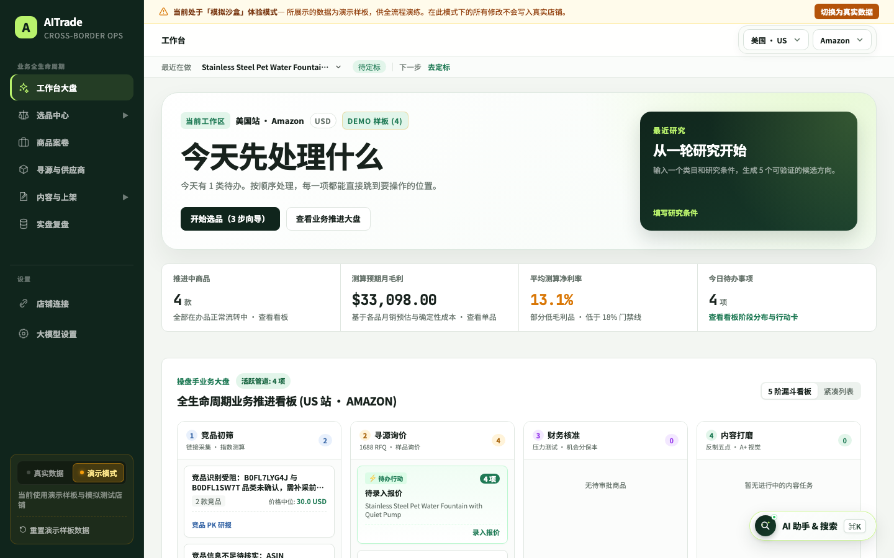
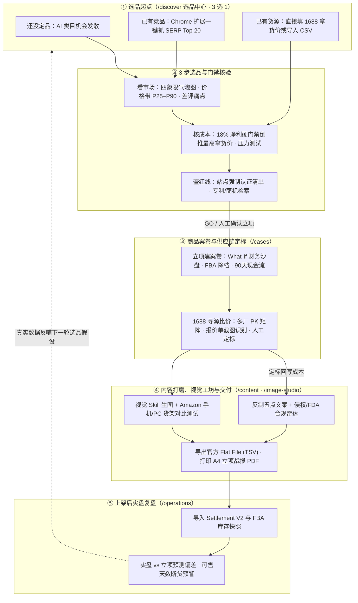

# AITrade

> **跨境电商“反亏钱”立项审计与选品决策工作台**  
> **AI 只生成待验证假设，结论由真实证据与确定性规则决定。**

无需 Docker、无需付费 API Key，本机 30 秒启动。覆盖 **选品研判 → 财务/物流/合规门禁 → 1688 寻源比价 → 内容与视觉工坊 → 实盘经营复盘** 全链路。



---

## 全链路业务流程



---

## 核心工作流一览

| 阶段 | 入口 | 核心能力 |
|---|---|---|
| **1. 选品中心** | `/discover` | **3 选 1 起点**（AI 找方向 / 竞品测格局 / 货源测毛利）+ **3 步极简向导**（看市场 → 核 18% 门禁 → 合规立项） |
| **2. 竞品研判** | `/competitors` | **市场格局四象限气泡图**（售价 × 评论壁垒 × 月销 × 评分痛点）、价格分位（P25–P90）、HHI 垄断指数与差评反制五点 |
| **3. 财务与合规门禁** | `/cases/[id]` | **交互式 What-If 财务沙盘**（瀑布图 + 售价×ACoS 热力矩阵）、**FBA 尺寸降档提醒 + 抛货头程 + 站点 VAT + 90 天现金流回本**、立项前置专利/认证红线清单 |
| **4. 1688 寻源比价** | `/cases/[id]/sourcing` | 多工厂横向 PK 矩阵与人工定标、**微信/1688 报价单截图多模态识别**、浏览器扩展半自动 1688 采集与 RFQ 内部草稿 |
| **5. 内容与视觉工坊** | `/content` `/image-studio` | 差评缺口自动传承到五点文案、侵权/FDA/广告法合规雷达、自定义视觉 Skill 图生图、**主图 Amazon 手机/PC 货架对比测试（Shelf Test）** |
| **6. 交付与实盘复盘** | `/operations` `/cases/[id]/report` | 一键导出 **Amazon 官方 Flat File (TSV)**、A4 **立项决策评审战报 PDF**、**Settlement V2 + FBA 库存实盘 vs 预测偏差与断货预警** |

### 全局效率体验
- **真实数据 / 演示模式双切换**：演示模式内置经典选品样板并支持一键重置；切至真实模式后彻底隔离 Demo 数据。
- **在场式 AI 副驾驶 & 全域检索（`⌘K` / `Ctrl+K`）**：自动感知当前案卷/研报上下文，实时输出 18% 门禁诊断与 1688 压价底牌话术（无 API Key 时自动回退确定性专家引擎）。
- **Chrome 采集扩展（用户触发，零后台爬虫）**：在亚马逊详情页（`/dp/`）或搜索页（`/s?k=...`）一键采集最多 20 款可见竞品；在 1688 搜索页一键采集可见工厂卡片。

---

## 快速开始

需要 **Node.js 20.9+**，内置嵌入式 PGlite，无需安装数据库或 Docker：

```bash
npm install
npm run dev
```

浏览器打开 <http://localhost:3000> 即可使用（数据默认存储在 `.data/`，首次启动自动生成演示样板）。

- **生产启动**：`npm run build && npm start`
- **健康检查**：`GET /api/health`（返回 DB 连通性延迟、运行模式与存储配置）

---

## 证据分级与安全边界

系统用确定性代码计算到岸成本、18% 净利率门禁与压力测试，**绝不让 AI 编造销量/售价或替用户凑齐证据**：

| 来源类型（`source_type`） | 说明 | 计入 GO 门禁 / 价格分位 |
|---|---|---|
| `marketplace` / `bulk_text_import` / `manual_verified` | 人工录入或粘贴真实表格 | 是 |
| `captured` | Chrome 扩展采集的前台真实数值 | 是（研报需人工确认） |
| `ai_model_site_import` / `template` / `demo` | AI 或模板推演素材 | **否** |

**明确边界**：
- **不自动外发**：不后台爬取平台、不绕过验证码、不自动联系供应商、不自动下单付款；发布链路由数据库 `CHECK (published = FALSE)` 锁死。
- **零门槛 CSV 导入**：`/data-sources` 与 `/import` 支持直接导入候选品、供应商、报价 CSV（模板位于 `public/*-template*.csv`），无需平台 API Key。
- **实盘复盘口径**：`/operations` 与 P3.0 计算层当前为零写入试算预览，不修改业务表。
- **本地单机原型**：当前无登录、多租户与角色权限体系；已预留 `StorageProvider` 抽象（本地 / S3 兼容）与 `.github/workflows/ci.yml` CI 门禁。

---

## 扩展与模型配置

### 1. Chrome 浏览器采集扩展
在 Chrome `chrome://extensions` 开启开发者模式并加载已解压扩展：
- **亚马逊竞品采集**：`extensions/aitrade-competitor-capture/`（支持 `/dp/` 单品详情页与 `/s?k=...` 搜索结果页 Top 20 一键采集）
- **1688 供应商采集**：`extensions/aitrade-supplier-capture/`（在 1688 当前搜索页点击采集并生成 TOP 10 候选）

### 2. AI 文本与生图模型
默认本地模板即可完整体验，无需 Key。可在 `/settings` 分别配置：
- **文本大模型**：`template`（免 Key）、`ollama`、`openai-compatible`、`anthropic-compatible`（请求失败自动回退模板）
- **生图模型**：`template`、`gemini`、`dashscope`（阿里云百炼）、`openai-compatible`、`anthropic-compatible`
- API Key 加密落盘且不回显到页面，环境变量示例见 [.env.example](.env.example)。

---

## 常用命令与目录

```bash
npm run typecheck                  # TypeScript 类型检查
npm test                           # 单元测试（225 项）
npm run build                      # 生产构建
npm run db:reset                   # 清空本地数据库与缓存
npm run report:dry-run -- --help   # P3.0 报表 CLI 只读试算
```

```text
src/app/         页面路由、Server Actions 与 API（含 /discover、/operations、/api/health）
src/components/  交互组件（选品向导、财务沙盘、四象限图、物流现金流、货架测试、生图工坊）
src/lib/         确定性经济/物流/合规/结算纯函数、AI 提案契约与仓储层
extensions/      Amazon 竞品采集 & 1688 供应商采集 Chrome 扩展
db/schema.sql    PostgreSQL / PGlite 表结构
```
