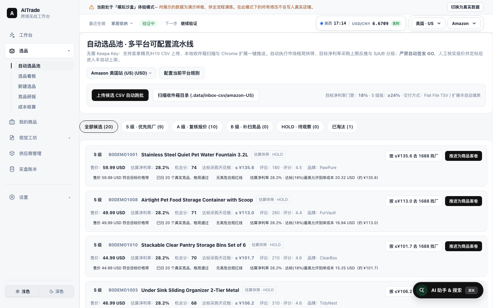
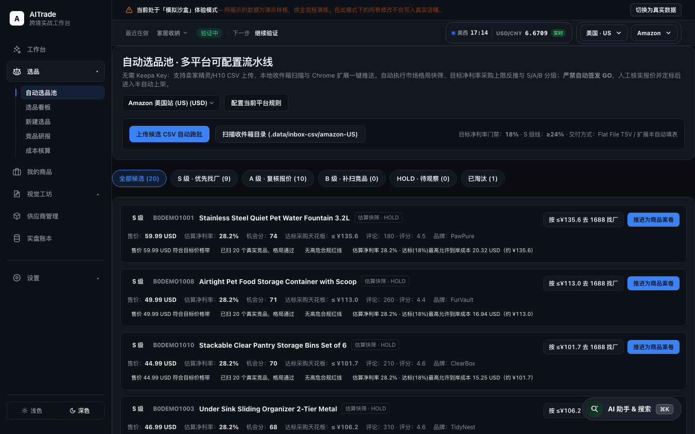

# AITrade

本地运行的跨境电商**多平台可配置全自动选品、1688 寻源、立项评审与半自动上架**工作台。

利润、压力测试和 18% 净利率门禁全部由确定性代码计算；AI 仅用于辅助发散选题、提取报价单和生成图文/视频草稿，不参与最终财务判定。**系统严禁自动签发 `GO` 与无人值守直接发布**，在“自动选品分级 → 人工核实报价定标 → 内容人工终审 → 半自动填表/导出上架”之间保留清晰的人工决策卡点。

选品与上架主线统一为：`选品初筛（多平台可配置快筛分诊） → 选品看板（4 步深度验证：竞品研报 / 成本核算 / 找厂打样 / 风险立项） → 人工定标 GO → 视觉/文案终审 → 半自动上架（扩展填表 / 多平台模板导出） → 实盘对账反哺`。

| 工作台 · 浅色模式 | 工作台 · 深色模式 |
|---|---|
|  |  |

| 自动选品 · 浅色模式 | 自动选品 · 深色模式 |
|---|---|
|  |  |

---

## 快速开始

环境要求：**Node.js 22.6+**。内置嵌入式 PGlite，无需安装外部数据库或 Docker：

```bash
npm install
npm run dev
```

启动后访问 <http://localhost:1688>（本地数据存放在 `.data/`，首次启动会自动写入演示数据，可在「设置 → 常规设置」切换到真实数据模式）。

- **生产构建与运行**：`npm run build && npm start`（不依赖 Google Fonts，断网可构建）
- **开启访问口令（可选）**：`APP_ACCESS_PIN=your-pin npm start`（通过 Next.js `proxy.ts` 拦截，Cookie 有效期 30 天）
- **健康检查**：`GET /api/health`

---

## 端到端工作流程（全自动选品 → 半自动上架）

```mermaid
flowchart LR
    subgraph S1["1. 全自动选品（多平台可配置 · 零 Keepa Key 可用）"]
        A1["Chrome 扩展一键推池 /<br/>卖家精灵·H10 CSV / 本地收件箱"] --> A2["市场格局 HHI·CR3 +<br/>合规红线确定性快筛"]
        A2 --> A3["18% 净利率反推采购上限 (¥)<br/>自动分级：S / A / B / HOLD / 淘汰"]
    end

    subgraph S2["2. 1688 寻源与人工定标（卡点 1）"]
        B1["S/A 级带采购天花板<br/>跳 1688 找厂 + 扩展抓报价"] --> B2["推进为商品案卷<br/>成本核算 + 拿样定标"]
        B2 --> B3{"财务与真实证据门禁"}
        B3 -->|"通过"| B4["人工确认 GO · 立项"]
        B3 -->|"缺报价 / 承压"| B5["HOLD / NO-GO"]
    end

    subgraph S3["3. 内容终审与半自动上架（卡点 2）"]
        C1["AI 生成五点/标题/搜索词<br/>视觉工坊生图·视频 + 主图预检"] --> C2["人工内容终审通过"]
        C2 --> C3["Chrome 扩展多平台一键填表 +<br/>多平台模板导出 (Amazon TSV / Shopify Draft CSV) + ZIP"]
        C3 --> C4["卖家后台人工传图并点击发布"]
    end

    subgraph S4["4. 实盘对账与校准"]
        D1["Settlement V2 + FBA 库存"] --> D2["实盘与预测利润对比"]
    end

    A3 --> B1
    B4 --> C1
    C4 --> D1
    D2 -.->|"校准后续测算"| A2

    classDef primary fill:#eff6ff,stroke:#1d4ed8,color:#0f172a,stroke-width:1.5px;
    classDef success fill:#ecfdf3,stroke:#15803d,color:#0f172a,stroke-width:1.5px;
    classDef warn fill:#fffbeb,stroke:#b45309,color:#0f172a,stroke-width:1.5px;

    class A1,A2,C1,C3 primary;
    class B4,C2,C4,D1 success;
    class A3,B1,B2,B3,B5,D2 warn;
```



---

## 主要功能

| 模块 | 路径 | 说明 |
|---|---|---|
| **工作台** | `/` | 站点时间与汇率换算、待办提醒、行业快讯和商品进度看板；全局 `⌘K` 支持命令面板检索（商品/研报/工厂/功能直达）与全站页面识别 AI 操盘手问答 |
| **选品初筛** | `/auto-pipeline` `/auto-pipeline/history` | 多平台可配置批量快筛分诊台（跟随顶部全局站点切换，内置 Amazon US/UK/DE/JP、Shopify US、TikTok Shop US，支持自定义平台/站点与阈值并与选品看板双向同步）。无需 Keepa Key：支持一键上传卖家精灵/H10 CSV、本地收件箱 `.data/inbox-csv/` 手动扫描或 **15 秒自动监听**（消费后自动归档至 `processed/` 防重复跑批）与 Chrome 扩展整页推送；内置实时 4 阶段自动化引擎流水线可视化、默认高密度可排序表格视图（支持切换卡片）+ 右侧详情抽屉 + 底部悬浮批量条，全链路采用统一 `SelectionStatus` 流转状态枚举，自动执行 HHI/CR3 与合规快筛、反推 18% 采购上限（¥）、匹配统一避坑库预警并输出 `S / A / B / HOLD / 淘汰` 分级；支持单条/批量**采纳进选品看板**、安全**取消采纳**、批量**淘汰入统一避坑库**、S/A 级快轨直达商品案卷与历史批次快照管理 |
| **选品看板** | `/ai-sourcing` `/discover` | 统一承接「选品初筛」采纳与右上角 `+ 添加选品 ▾`（AI 类目找方向 / 从已确认竞品研报建品 / 从已确认成本核算单建品）进入的高价值候选，按 4 步验证漏斗（竞品研报 → 成本核算 → 找厂打样 → 风险立项）推进，统一维护避坑库，人工定标后签发 `GO / NO-GO` |
| **竞品研报** | `/competitors` | 支持浏览器扩展采集、**卖家精灵 / Helium 10** CSV 导入和 AI 整理；从候选进入时会锁定站点、平台与币种，确认并绑定后返回原候选 |
| **成本核算** | `/costing` | 建立可追溯的售价、采购、头程、履约费与平台费率版本；草稿可迭代，确认后的最新版本才可作为候选 GO 与正式立项依据 |
| **商品案卷与半自动上架** | `/cases` `/cases/[id]` | 单品阶段直达、利润沙盘、18% 净利率与盈亏平衡 ACoS 核算；文案工作台支持 AI 一键生成与本地预检，人工终审通过后可通过 `GET /api/cases/[id]/listing-payload?platform=...` 供扩展一键后台填表，或导出增强版多平台模板（Amazon Flat File TSV / Shopify Draft CSV / 通用 TSV）、上架素材包 ZIP 与 A4 立项评审 PDF |
| **视觉工坊** | `/studio` | AI 生图、图生视频（I2V）、`ffmpeg` 多镜头拼接及素材库管理，支持主图审核状态与分辨率预检 |
| **供应商与打样** | `/sourcing` | 1688 工厂记录、多厂报价对比与定标、报价单截图识别、抛货头程计算和拿样记录 |
| **实盘账本** | `/operations` | 导入 Amazon Settlement V2 与 FBA 库存表、SKU 成本映射与广告费重叠防重扣校验，核对实盘利润与可售天数并自动校准后续立项与决策模型 |
| **设置** | `/settings` `/fx-rates` `/audit-logs` | 常规设置（真实/演示模式）、大模型配置、整库备份与恢复、8 种常用汇率管理、全链路操作日志 |

---

## 数据规则与边界

- **缺数据不放行 `GO`**：自动选品在类型与数据库约束层面严格禁止自动签发 `GO`（仅输出 `HOLD / NO-GO / PENDING` 与估算净利率）；缺少真实竞品售价或尚未定标工厂报价时，系统只输出 18% 门禁下的最高允许到岸成本。
- **多平台配置化，不写死单一平台**：平台佣金率、履约费模型、广告费率、快筛红线、S/A 分级阈值与半自动上架交付方式全部存储在 `auto_pipeline_configs` 中，可按 `platform_code + market_code` 自由增改。
- **不做外部违规自动操作**：不包含后台未授权爬虫、验证码绕过、自动联系供应商、自动下单付款或无人值守直接 Live 上架；半自动上架必须经人工内容终审后，由运营在已登录后台核对并点击发布。
- **演示模式与正式模式隔离**：演示模式可跳过部分人工确认步骤并写入 `demoBypass` 审计标记；正式模式严格执行人工确认与版本范围校验。
- **备份与密钥隔离**：API Key 用 AES-256-GCM 加密保存在本地 `.data/` 且不回显；`/settings?tab=backup` 导出不含密钥的业务 JSON，恢复前自动保存快照至 `.data/backups/`。
- **本地库单实例保护**：PGlite 数据目录同一时间只允许一个进程打开；检测到重复启动会直接报错并保留原库。
- **操作可追溯**：自动选品批跑、平台规则修改、候选推进、报价定标、实盘校准、数据采集、半自动上架 Payload 拉取与模板导出均完整记录在 `/audit-logs`。

---

## 扩展与模型配置

### Chrome 实战助手（选品 + 1688 寻源 + 半自动上架三合一）
在 `chrome://extensions` 开启开发者模式，加载 `extensions/aitrade-assistant/`：
- **自动选品推送**：在 Amazon 搜索页 (`/s?k=...`) 点击「推送到自动选品」，将整页真实竞品直接送入 `/auto-pipeline` 自动快筛、反推采购上限并分级。
- **竞品研报采集**：在 Amazon 详情页 (`/dp/`) 或搜索页提取真实售价、评分、评论数和 1–3 星差评，支持对比篮子多品打包推送。
- **1688 工厂采集**：在 1688 搜索页一键抓取可见工厂与人民币报价，按当前汇率换算写入对应商品比价表。
- **多平台半自动上架填表**：登录 Amazon Seller Central / Shopify Admin / TikTok Shop Seller 添加商品页后，选择目标平台与已通过人工内容终审的商品案卷，一键填入标题、品牌、SKU、售价、五点卖点、描述与搜索词，并在右下角弹出悬浮复制助手（新增平台只需在 `extensions/aitrade-assistant/autofill-profiles.js` 增加一份选择器映射）。

### 模型配置（可选）
不填任何 API Key 也可以用本地模板模式走完流程。如需接入模型，在 `/settings?tab=models` 添加即可（支持脱敏导出/导入，环境变量参考 [.env.example](.env.example)）：
- **文本**：OpenAI、DeepSeek、Claude、豆包方舟、阿里云百炼、硅基流动、Ollama 及兼容网关
- **图片**：阿里云百炼、即梦 Seedream、Gemini、FLUX / Kolors、CogView-4、fal.ai、Ideogram
- **视频**：可灵 Kling、通义万相、豆包 Seedance、Veo、Runway Gen-4、Sora

---

## 常用命令与目录

```bash
npm run typecheck                  # TypeScript 类型检查
npm run theme:check                # 浅色/深色主题变量检查
npm test                           # 全量单元测试
npm run test:e2e                   # Playwright 核心流程冒烟测试
npm run screenshots                # 重拍工作台与自动选品深浅双模截图
npm run build                      # 本地生产构建
npm run db:reset                   # 清空本地 PGlite 数据库与缓存
```

```text
src/app/         页面路由（含 /auto-pipeline 及 /auto-pipeline/history）、Server Actions 与 API
src/components/  前端组件
src/lib/         自动选品编排 (auto-pipeline/)、多平台交付 (listing-delivery.ts)、
                 利润/物流/合规/结算/汇率计算、AI 适配与数据库层
src/proxy.ts     Next.js 16 请求代理（可选 APP_ACCESS_PIN）
extensions/      Chrome 三合一实战助手（Amazon 选品 + 1688 寻源 + 多平台半自动上架）
e2e/             Playwright 冒烟测试
db/schema.sql    PGlite 表结构（PostgreSQL 语法兼容）
```
