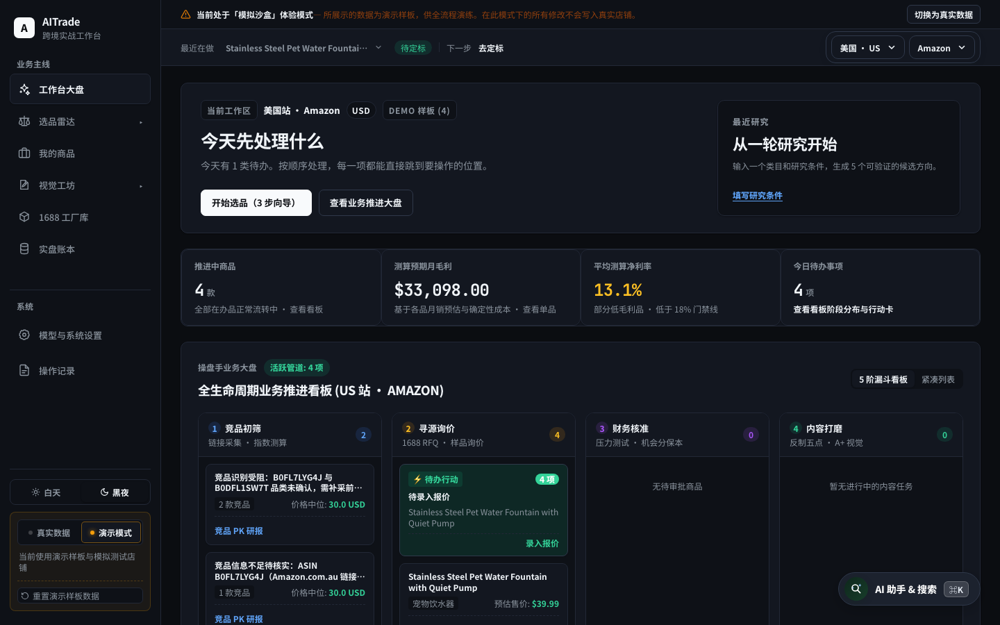
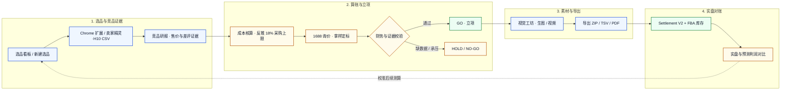

# AITrade

本地运行的跨境电商选品算账、1688 寻源与立项评审工具。

利润、压力测试和 18% 净利率门禁全部由确定性代码计算；AI 仅用于辅助发散选题、提取报价单和生成图文/视频草稿，不参与最终财务判定。

选品主线现在统一为：`选品 → 选品看板 / 新建选品 → 候选证据补齐（竞品研报 / 成本核算） → 选厂与立项`。竞品研报和成本核算既可从侧栏独立使用，也可带着候选上下文进入；补齐后自动返回原候选和原 Tab，不重复录入站点、平台与币种。

| 浅色模式 | 深色模式 |
|---|---|
|  |  |

---

## 快速开始

环境要求：**Node.js 22.6+**。内置嵌入式 PGlite，无需安装外部数据库或 Docker：

```bash
npm install
npm run dev
```

启动后访问 <http://localhost:1688>（本地数据存放在 `.data/`，首次启动会自动写入演示数据，可在「设置 → 常规设置」切换到真实数据模式）。

- **生产构建与运行**：`npm run build && npm start`（不依赖 Google Fonts，断网可构建）
- **开启访问口令（可选）**：`APP_ACCESS_PIN=your-pin npm start`（通过 Next.js `proxy.ts` 拦截，Cookie 有效期 30 天）
- **健康检查**：`GET /api/health`

---

## 工作流程



---

## 主要功能

| 模块 | 路径 | 说明 |
|---|---|---|
| **工作台** | `/` | 站点时间与汇率换算、待办提醒、行业快讯和商品进度看板；全局 `⌘K` 支持命令面板检索（商品/研报/工厂/功能直达）与全站页面识别 AI 操盘手问答 |
| **选品看板** | `/discover` | 从候选池、供应链入口和商品机会进入统一选品流程；支持竞品价格分布与候选推进，不另建第二套工作流 |
| **新建选品** | `/discover` | 支持 AI 找方向、从已确认竞品研报建立候选、从已确认核算单建立候选；创建后进入同一套 4 步选品工作台 |
| **竞品研报** | `/competitors` | 侧栏可独立使用；支持浏览器扩展采集、**卖家精灵 / Helium 10** CSV 导入和 AI 整理。从候选进入时会锁定站点、平台与币种，确认并绑定后返回原候选 |
| **成本核算** | `/costing` | 侧栏可独立使用；建立可追溯的售价、采购、头程、履约费与平台费率版本。草稿可迭代，确认后的最新版本才可作为候选 GO 与正式立项依据 |
| **商品案卷** | `/cases` `/cases/[id]` | 侧边栏二级台账与单品阶段直达、成本与利润沙盘、18% 净利率与盈亏平衡 ACoS 核算、实盘偏差反哺校准；文案工作台支持 AI 一键填写商品定义与目标站点 Listing 草稿、右侧手机端实时预览与 PC 端大图弹窗，演示模式可跳过定标预览，支持导出上架 ZIP、Flat File (TSV) 和深浅双模 A4 立项评审 PDF |
| **视觉工坊** | `/studio` | AI 生图、图生视频（I2V）、`ffmpeg` 多镜头拼接及素材库管理 |
| **供应商与打样** | `/sourcing` | 1688 工厂记录、多厂报价对比与定标、报价单截图识别、抛货头程计算和拿样记录 |
| **实盘账本** | `/operations` | 导入 Amazon Settlement V2 与 FBA 库存表、SKU 成本映射与广告费重叠防重扣校验，核对实盘利润与可售天数并自动校准后续立项与决策模型 |
| **设置** | `/settings` `/fx-rates` `/audit-logs` | 常规设置（真实/演示模式）、大模型配置、整库备份与恢复、8 种常用汇率管理、全链路操作日志 |

---

## 数据规则与边界

- **缺数据不放行 `GO`**：缺少真实竞品售价或尚未定标工厂报价时，系统仅输出估算结果与 18% 门禁下的最高允许到岸成本，不会给出正式 `GO`。
- **演示模式可跳过人工确认与绑定门禁**：竞品研报可直接确认并绑定当前候选，研报可自动确认后建立候选；成本核算支持“保存、确认并绑定”一步完成，也可在绑定下拉中选择最新草稿并自动确认。自动操作会写入审计日志，并标记 `demoBypass`。
- **正式模式仍要求人工确认**：竞品研报、成本核算和候选绑定继续保留人工确认与版本校验，不会因演示流程而放宽。
- **候选上下文口径锁定**：从候选进入竞品研报或成本核算时，站点、平台与币种按候选锁定；演示模式可以跳过确认流程，但不能绕过站点、平台、币种或旧版本范围校验。
- **不做外部自动操作**：不包含后台爬虫、验证码绕过、自动联系供应商、自动下单付款或自动上架 Listing。
- **备份与密钥隔离**：API Key 用 AES-256-GCM 加密保存在本地 `.data/` 且不回显；`/settings?tab=backup` 导出不含密钥的业务 JSON，恢复前会先做预检并自动保存快照至 `.data/backups/`。
- **操作可追溯**：案卷修改、报价定标、实盘校准、SKU 映射、1688 待回补登记、数据采集、素材导出、备份恢复与口令解锁均完整记录在 `/audit-logs`，支持筛选和 CSV 导出。

---

## 扩展与模型配置

### Chrome 采集扩展
在 `chrome://extensions` 开启开发者模式，加载 `extensions/aitrade-assistant/`：
- **Amazon 搜索页 / 单品页 / 评论页**：提取当前页真实售价、评分、评论数和 1–3 星差评；字段解析缺失时会显性提示，不补默认值。
- **1688 搜索页 / 详情页**：提取工厂信息与人民币报价，按当前汇率换算后写入对应商品比价表。

### 模型配置（可选）
不填任何 API Key 也可以用本地模板模式走完流程。如需接入模型，在 `/settings?tab=models` 添加即可（支持脱敏导出/导入，环境变量参考 [.env.example](.env.example)）：
- **文本**：OpenAI、DeepSeek、Claude、豆包方舟、阿里云百炼、硅基流动、Ollama 及兼容网关
- **图片**：阿里云百炼、即梦 Seedream、Gemini、FLUX / Kolors、CogView-4、fal.ai、Ideogram
- **视频**：可灵 Kling、通义万相、豆包 Seedance、Veo、Runway Gen-4、Sora

---

## 常用命令与目录

```bash
npm run typecheck                  # TypeScript 类型检查
npm run theme:check                # 浅色/深色主题变量检查
npm test                           # 全量单元测试（282 项）
npm run test:e2e                   # Playwright 核心流程冒烟测试
npm run build                      # 本地生产构建
npm run db:reset                   # 清空本地 PGlite 数据库与缓存
```

```text
src/app/         页面路由、Server Actions 与 API
src/components/  前端组件
src/lib/         利润/物流/合规/结算/汇率计算、AI 适配与数据库层
src/proxy.ts     Next.js 16 请求代理（可选 APP_ACCESS_PIN）
extensions/      Chrome 采集扩展（Amazon + 1688）
e2e/             Playwright 冒烟测试
db/schema.sql    PGlite 表结构（PostgreSQL 语法兼容）
```
