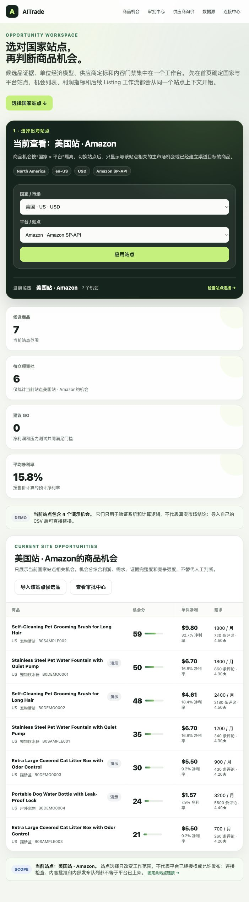
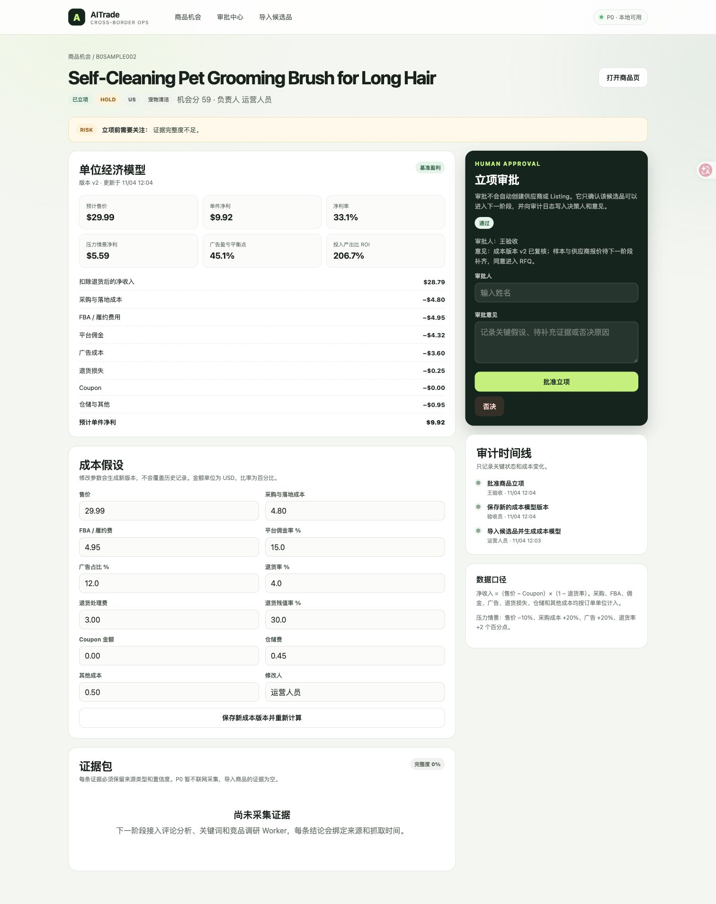
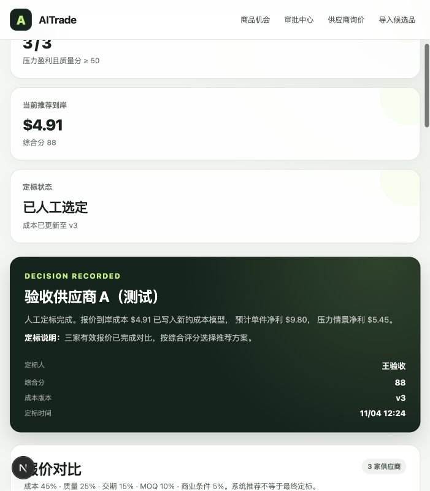
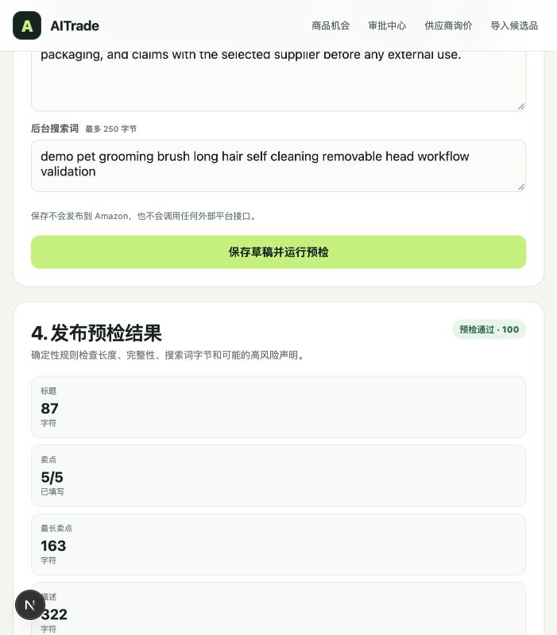
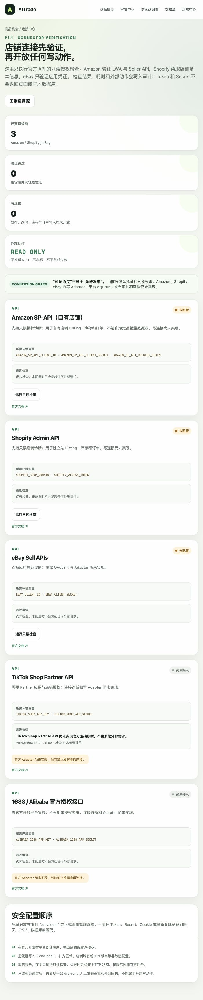
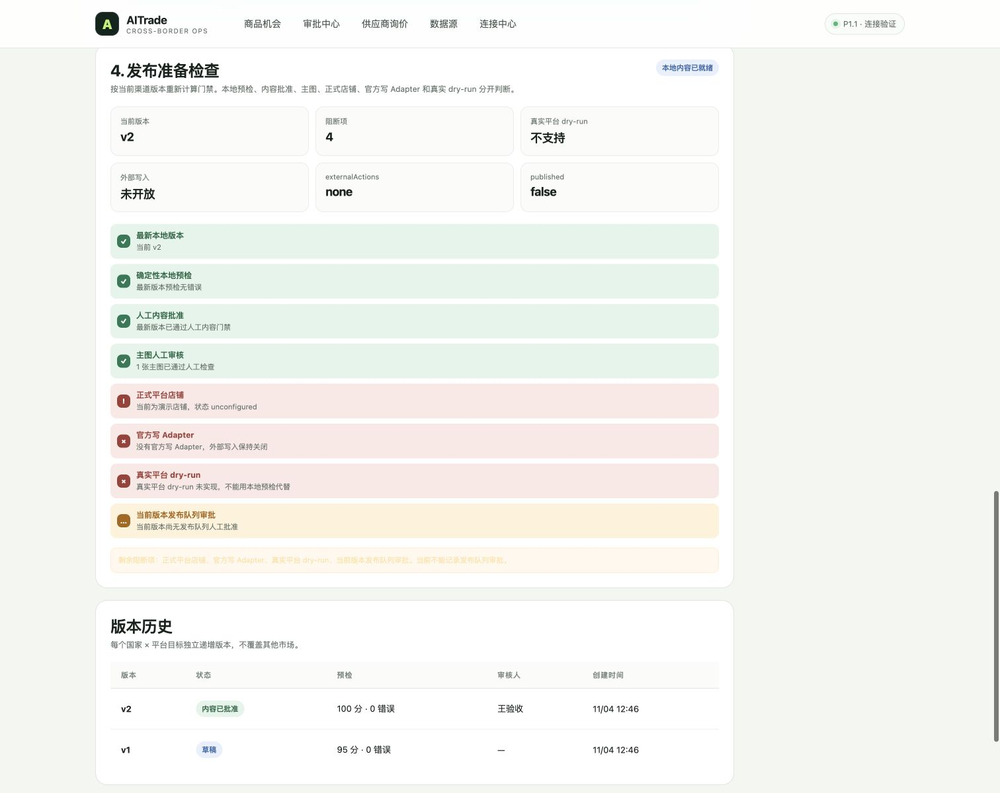
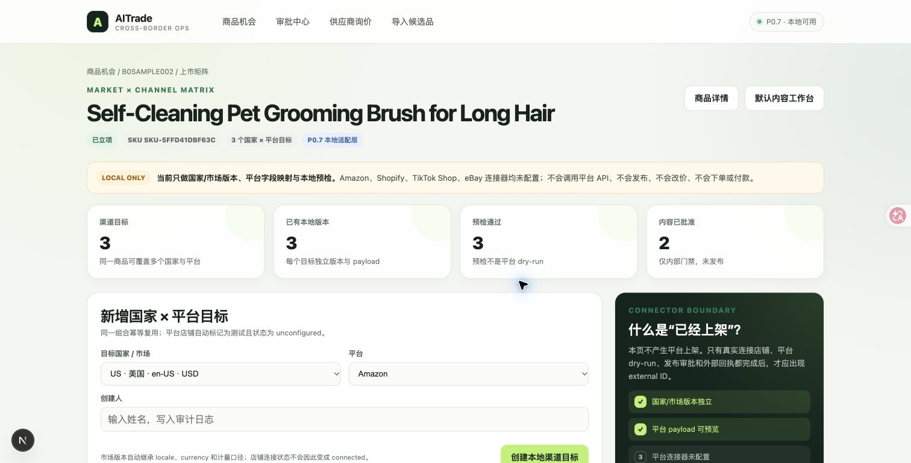
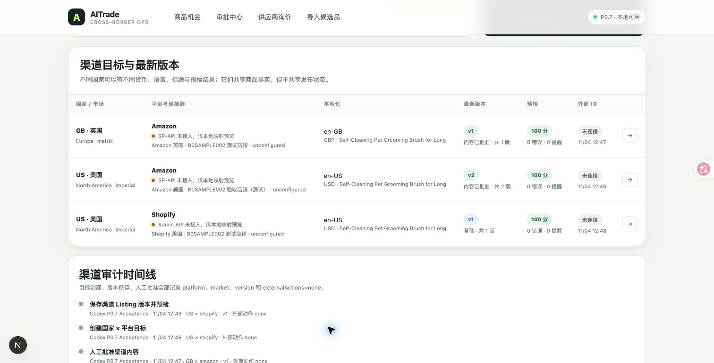

# AITrade

面向跨境电商的 AI 运营工作台。目标不是替代 ERP，而是把选品、供应商、内容生产、上架和运营异常沉淀成可审计、可审批、可复用的工作流。

当前仓库是一个**可运行的 P1.1 数据底座 + 纵向业务切片 + 只读连接诊断**。真实候选品、供应商和报价可以通过 CSV 或人工通道入库，保留来源、采集时间、运行记录和原始快照；已跑通：

```text
候选品 / 供应商 / 报价真实数据接入
→ CSV 导入、幂等去重、运行记录与证据快照
→ 可选 Keepa 只读 ASIN 商品数据同步
→ Amazon / Shopify / eBay 只读连接检查
→ 生成证据占位与单位经济模型
→ 商品机会看板
→ 修改成本假设并生成新版本
→ 人工立项审批
→ 录入供应商报价并计算到岸成本
→ 多供应商评分与风险提示
→ 人工定标并回写成本模型
→ 商品定义与供应商授权边界
→ 主图上传、格式校验与人工检查
→ Listing 草稿版本化与确定性发布预检
→ 多国家 × 多平台渠道目标
→ 平台字段映射与独立市场版本
→ 人工内容批准
→ 确定性发布准备门禁（8 项检查）
→ 人工发布队列审批
→ 状态同步与审计时间线
```















## 当前能力

- 独立“数据源”工作台 `/data-sources`，统一展示数据源就绪度、真实数据量、最近 20 次导入和告警
- 统一导入 API `/api/ingestion`，支持候选品、供应商、报价和 Keepa 四类通道
- CSV 文件上传或直接粘贴导入；候选品最多 200 行，供应商和报价最多 1,000 行，CSV 最大 2 MB
- 中英文字段名兼容，重复 `asin + marketplace` 幂等跳过；供应商按平台 + 外部 ID、规范化链接或名称去重
- 候选品导入显式绑定“国家 × 平台站点”；同一商品可关联多个站点，机会看板和指标严格按当前站点隔离
- 每个导入批次生成 `ingestion_runs`，记录文件、入口方式、新增/更新/跳过/失败、快照、告警和完成时间
- 每条真实数据保留 `source_code`、`source_record_id`、`observed_at` 和 `evidence_snapshots` 原始快照
- 候选品支持销量区间、币种、BSR、关键词搜索量、卖家数、变体数和完整成本假设
- 报价支持运费、关税率、币种、有效期、开模费、付款条件、Incoterms、认证和供应商外部 ID
- Keepa Adapter 只读同步指定 ASIN；未配置 `KEEPA_API_KEY` 时返回 409，不发起外部请求，也不伪造数据
- 独立“连接中心” `/connections`：Amazon 验证 LWA + Seller API，Shopify 验证自有店铺只读访问，eBay 只验证应用凭证
- 每次连接检查写入 `connector_health_checks` 和 `connector.health_checked` 审计；页面与数据库均不保存或回显 Token、Secret
- TikTok Shop 与 1688 明确显示“尚未接入”，检查结果标记为 `unsupported`，不发起外部请求，也不伪造连接状态
- 确定性单位经济模型：净收入、佣金、广告、退货损失、压力测试、ROI
- 首页选择国家/市场与平台站点后，按机会分展示该站点商品机会，并同步计算候选数、GO 数、平均净利率与待审批数
- 成本参数修改与版本化历史
- 人工批准/否决立项
- 审批状态、成本版本和关键动作写入审计日志
- 供应商档案和报价录入，报价包含运费、关税率、质量分、MOQ、交期、样品费和认证
- 确定性到岸成本、单位经济模型、综合评分和风险标签
- 供应商横向对比、系统推荐与人工定标
- 定标后自动生成新的成本模型版本，并记录定标人、说明、评分快照和成本版本
- 同一商品只允许人工定标一次；定标后锁定新增报价和重复定标
- 供应商定标后解锁商品定义工作台，记录产品事实、目标用户、差异点、规格和禁用声明
- 主图仅接受真实 JPG / PNG / WebP（最大 8 MB）并保存到本地；白底、商品完整、文字水印和分辨率由人逐项确认
- Listing 标题、五点描述、描述和后台搜索词结构化保存；每次保存生成新版本
- 确定性发布预检检查长度、完整性、搜索词 UTF-8 字节和常见高风险声明
- 只有预检通过且至少有一张已人工审核的主图时，才允许记录人工内容批准
- 商品定义、图片上传与审核、Listing 版本和内容批准全部写入审计时间线
- 同一商品可创建多个国家 × 平台渠道目标，各自维护 locale、currency、Listing 版本和预检结果
- 内置 Amazon、Shopify、TikTok Shop、eBay、CSV / 人工的本地字段映射预览；Amazon 保留 SP-API 形状，Shopify 默认 draft，TikTok Shop 保留 selling points
- 平台渠道目标仍使用未配置的本地测试店铺，外部 ID 保持为空；内容批准审计写入 `externalActions: none`
- 渠道级发布准备门禁按最新版本、本地预检、内容批准、主图审核、正式店铺、写 Adapter、平台 dry-run 和当前版本发布队列审批 8 项条件确定性计算
- 发布准备状态为 `blocked`、`local_ready`、`dry_run_unsupported`、`approval_pending`、`approved_for_publish`；只有 `approval_pending` 无阻断项时，人工才能批准进入内部发布队列
- `channel_launch_reviews` 固化审批时的检查快照、审批人、说明和版本 ID，并强制记录 `externalActions: none`、`published: false`
- 4 个演示商品和真实数据导入模板；示例模板明确标注为示例，不冒充认证供应商或真实市场结论

## 明确边界

P1.1 覆盖真实候选品、供应商和报价接入、平台只读授权诊断，并继续贯通“候选品 → 成本模型 → 人审立项 → 供应商报价对比 → 人审定标 → 商品定义 → 主图人审 → 多国家/多平台 Listing 草稿与本地预检 → 人工内容批准 → 发布准备门禁 → 内部发布队列审批”。它是可运行的数据底座与业务原型，不是生产系统。

当前真实接入状态：

- **已实现**：候选品 CSV、供应商 CSV、报价 CSV、人工报价录入、Keepa ASIN 只读同步
- **已实现只读诊断**：Amazon SP-API 自有店铺、Shopify Admin API、eBay 应用凭证
- **已实现内部审批**：渠道发布准备检查与人工发布队列审批；审批只进入内部队列，不产生平台发布
- **只做本地适配预览**：Amazon、Shopify、TikTok Shop、eBay Listing 字段映射
- **已注册但未接入**：TikTok Shop Partner API、1688 / Alibaba 官方授权接口
- **尚未实现**：所有平台的真实平台 dry-run、写 Adapter、eBay 卖家 OAuth 完整链路、发布与外部回执

以下能力尚未实现：

- 自动生成/导出 RFQ、自动联系供应商、询价回复解析
- 样品管理、打样、质检和合规文件归档
- AI 图片生成、A+ 自动排版、品牌授权自动核验和类目合规引擎
- 平台密钥托管、eBay 卖家 OAuth、平台 dry-run、发布、改价、库存同步和广告操作
- 登录、角色权限和多租户
- 评论、关键词和竞品证据的规模化联网采集；Keepa 目前只覆盖商品层只读字段

系统不会自动生成或发送 RFQ、联系供应商、定标、签合同、下单或付款，也不会把本地 Listing 草稿发布到平台。CSV 导入只入库，所有真实导入默认记录 `externalActions: none`；Keepa 与已支持的连接诊断仅记录 `read_only`。连接验证成功只证明当前凭证可完成对应只读请求，不代表平台发布权限、类目合规或商品已上架。当前所有平台均为 `dryRunSupported=false`、`publishingSupported=false`；`approved_for_publish` 只表示批准进入内部发布队列，不等于平台发布，外部商品 ID 仍为空。演示数据只用于验证系统和计算逻辑，不代表真实市场结论或图片授权。

## 技术栈

- Next.js 16 + React 19 + TypeScript
- PGlite（本地嵌入式 PostgreSQL）
- Node.js 20.9+
- 不依赖 Docker

数据库目录默认为 `.data/aitrade`，位于 `.gitignore` 中。SQL 保持 PostgreSQL 兼容，后续可以迁移到正式 PostgreSQL。

## 本地启动

```bash
npm install
npm run dev
```

打开 <http://localhost:3000>。

生产模式验证：

```bash
npm run build
npm start
```

首次启动时，如果 `product_cases` 为空，会自动写入 4 个演示商品。

## 站点级商品机会

首页是站点工作区入口。先选择“国家 / 市场”和“平台 / 站点”，再查看商品机会；地址栏会保留当前范围，例如：

```text
/?market=US&platform=amazon#opportunities
/?market=US&platform=tiktok_shop#opportunities
```

商品机会不是按商品表里的单一 `marketplace` 字段粗略过滤，而是通过 `product_case_sites(case_id, market_code, platform_code)` 显式归一：

- 首页只显示明确关联到当前 `国家 × 平台` 的候选品，或已经建立同站点渠道目标的商品
- 切换国家或平台后，机会列表、机会数、建议 GO、平均净利率和待审批数量会一起变化
- 同一商品可以在多个站点分别立项；从 Amazon 再导入 TikTok Shop 时会新增站点关系，不复制商品
- 旧数据启动时只回填为原 `marketplace × amazon`，不会自动出现在其他平台
- 非 Amazon 候选品不会自动生成 Amazon 测试店铺或 Listing

从首页、`/import` 或数据源工作台导入候选品时，必须确认目标国家与平台；导入成功后会返回对应站点机会页。CSV 中的 `marketplace` 会被当前选择的国家覆盖，避免文件内容和页面范围不一致。

## 接入真实数据（P1.1）

进入“数据源”页面 `/data-sources`，可以分别导入候选品、供应商、报价，或同步 Keepa ASIN。旧的“导入候选品”页面 `/import` 仍保留兼容，但新字段和运行记录以数据源工作台为准。

### 候选品 CSV

模板：`public/candidates-template-v2.csv`

最小字段：

```text
asin,marketplace,title,competitor_price
```

推荐完整字段：

```text
source,source_record_id,observed_at,asin,marketplace,category,title,url,
competitor_price,currency,monthly_sales_min,monthly_sales_max,review_count,
rating,bsr,keyword,keyword_search_volume,seller_count,variation_count,
landed_cost,fba_fee,referral_rate,ad_rate,return_rate,return_processing,
return_recovery_rate,coupon,storage_cost,other_cost,notes
```

- `title` 和 `competitor_price` 必须有有效值
- 导入前选择目标“国家 / 市场”和“平台 / 站点”；站点归属写入 `product_case_sites`
- 没有 `asin` 时会生成临时编号；同一 `asin + marketplace` 重复导入会跳过
- 没有 `landed_cost` 时暂按售价的 30% 估算，仅适合早期筛查，不能替代真实报价
- 当前成本模型不盈利的候选品会被拒绝导入
- `monthly_sales_min` / `monthly_sales_max` 会保留区间，估算值为区间中位数
- `observed_at` 不会被导入时间覆盖；没有填写时使用导入时刻
- 比率字段可写 `15` 或 `15%`，系统按百分比解释

### 供应商 CSV

模板：`public/suppliers-template.csv`

关键字段：

```text
supplier_platform,external_supplier_id,supplier_name,supplier_url,
country,contact,category,rating,verified,moq,lead_time_days,
certifications,observed_at
```

供应商身份按以下顺序归一化：平台 + 外部供应商 ID、平台 + 规范化链接、平台 + 名称。重复导入会更新档案，不会重复建档；规范化链接会移除常见追踪参数并统一大小写。

### 报价 CSV

模板：`public/quotes-template.csv`

报价必须用 `asin + marketplace` 或 `case_id` 关联一个**已人工立项**的商品。关键字段：

```text
case_id,asin,marketplace,supplier_platform,external_supplier_id,
supplier_name,supplier_url,supplier_contact,supplier_country,
supplier_category,unit_price,freight_per_unit,duty_rate,quality_score,
moq,lead_time_days,payment_terms,incoterm,sample_fee,tooling_fee,
certifications,quote_valid_until,currency,observed_at
```

报价通过规范化报价哈希幂等去重。导入会创建或复用供应商、报价、来源快照和审计记录，但不会生成或发送 RFQ，不会自动定标，也不会产生采购承诺。

### Keepa（可选）

在 `.env.local` 或密钥管理系统中配置：

```bash
KEEPA_API_KEY=
```

配置后可在数据源工作台按市场输入 ASIN，单次最多 100 个。Adapter 调用 `https://api.keepa.com/product`，只读同步商品价格、销量估计、评论、评级和类目等字段。缺少 Key 时接口返回 `409 not_configured`，不会发起外部请求；销量、费用和评级仍需人工核验，成本模型中的部分成本是保守占位值。

API Secret 只能放在 `.env.local` 或密钥管理系统中，禁止写入数据库、源码、CSV、日志或聊天。

### 店铺连接中心（P1.1）

进入 `/connections` 运行只读授权检查，或调用：

```bash
curl -X POST http://localhost:3000/api/connections/check \
  -H 'Content-Type: application/json' \
  -d '{"code":"shopify","actor":"本地管理员"}'
```

支持范围：

- `amazon_sp_api`：刷新 LWA Token，并调用 Seller API 的 `marketplaceParticipations`，确认自有店铺与市场访问权限
- `shopify`：调用 Admin REST `shop.json`，只读取店铺名、币种和国家；域名必须是 `*.myshopify.com`
- `ebay`：只验证 client credentials 应用凭证；这不等于卖家 OAuth 或 Sell API 权限已验证
- `tiktok_shop` / `alibaba_1688`：返回 `unsupported`，不发起外部请求

所需非敏感配置和凭证变量如下，完整模板见 `.env.example`：

```bash
AMAZON_SP_API_REGION=na # na | eu | fe
AMAZON_SP_API_CLIENT_ID=
AMAZON_SP_API_CLIENT_SECRET=
AMAZON_SP_API_REFRESH_TOKEN=

SHOPIFY_SHOP_DOMAIN=your-shop.myshopify.com
SHOPIFY_ACCESS_TOKEN=
SHOPIFY_API_VERSION=2026-10

EBAY_ENVIRONMENT=production # sandbox 仅用于测试
EBAY_CLIENT_ID=
EBAY_CLIENT_SECRET=
```

检查结果写入 `connector_health_checks`，记录状态、验证层级、耗时、检查人和非敏感详情；审计动作是 `connector.health_checked`，并固定记录 `credentialsExposed: false`。所有外部请求超时为 15 秒。缺少凭证时接口返回 `409 not_configured`，不会写入成功记录或发起网络请求。

当前写连接数仍为 0：没有新增、修改、发布、改价、库存写入、订单写入、退款或付款接口。

## 成本口径

```text
净收入 =（售价 − Coupon）×（1 − 退货率）
佣金 = 净收入 × 佣金率
广告 = 扣 Coupon 前收入 × 广告占比
退货损失 = 退货率 ×（退货处理费 + 采购成本 × (1 − 残值率)）
单件净利 = 净收入 − 采购 − FBA − 佣金 − 广告 − 退货损失 − 仓储 − 其他
```

压力情景：

- 售价下降 10%
- 采购成本上升 20%
- 广告占比上升 20%
- 退货率增加 2 个百分点

建议规则：

- 压力情景不盈利：`NO-GO`
- 机会分 ≥ 65 且净利率 ≥ 18%：`GO`
- 其他：`HOLD`

## 供应商询价与人工定标

商品通过人工立项后，会出现在“供应商询价”页面。当前流程是人工录入真实询价结果，系统负责确定性计算、横向比较和审批留痕：

1. 录入供应商档案与报价：采购单价、单件运费、关税率、MOQ、交期、质量分、样品费、贸易条款、付款条件和认证信息。
2. 系统计算到岸成本与单位经济结果：

   ```text
   关税 =（采购单价 + 单件运费）× 关税率
   到岸成本 = 采购单价 + 单件运费 + 关税
   ```

3. 按综合评分排序：成本 45%、质量 25%、交期 15%、MOQ 10%、样品费与认证 5%。
4. 只有“压力情景净利 > 0 且质量评分 ≥ 50”的报价通过入选门槛。系统推荐只是排序建议，不能替代人工定标。
5. 建议至少比较 3 家有效报价；少于 3 家仍可定标，但定标说明为必填。
6. 人工确认后，系统创建 `supplier_selections` 记录，把所选报价的到岸成本写入新的成本模型版本，并记录定标人、说明、评分快照和审计日志。

同一商品只允许人工定标一次。定标后，页面锁定新增报价和重复定标；人工审批、联系供应商、打样、下单和付款仍保留人工控制。

当前实现不改变商品主状态枚举：商品仍为 `approved`，供应商是否已定标由 `supplier_selections` 表达。这样可以避免把“已立项”和“已定标”错误合并成同一个状态。

## 商品定义、主图与内容批准

供应商定标后可从定标结果或商品详情进入内容工作台：

1. 保存商品定义：商品名称、目标用户、核心差异点、规格材质、包装清单、禁用声明和编辑人。
2. 上传主图。服务端检查文件头与 MIME 类型，只接受 JPG / PNG / WebP，最大 8 MB；文件通过受控接口读取，不信任任意客户端路径。
3. 人工逐项确认白底或纯色背景、商品完整性、无未经批准文字/水印、分辨率与画质，并记录审核人、说明和审计日志。
4. 保存 Listing 草稿。标题、五条卖点、描述和后台搜索词都会进入确定性预检；每次保存创建新版本，旧版本保留。
5. 预检通过且至少一张主图通过人工检查后，记录人工内容批准。

当前预检不替代任何平台的真实 dry-run，也不检查真实品牌授权、认证文件、类目必填字段或知识产权。`content_approved` 不是 `published`：它只表示该国家 × 平台版本已通过内部内容门禁，系统不会调用外部平台接口。

## 多国家、多平台上市矩阵

完成商品定义和主图审核后，可以从商品详情或内容工作台进入“上市矩阵”：

1. 选择国家/市场和平台，创建独立渠道目标。同一商品、国家、平台组合幂等复用。
2. 每个国家维护独立的 `product_market_variant`，继承市场 locale、currency 和计量口径；每个平台维护独立的 `channel_listing` 与版本序列。
3. 保存 Listing 时生成三层产物：canonical snapshot、平台适配 payload、本地预检结果。不同目标不会覆盖彼此的版本。
4. 当前内置市场为 US、GB、DE、JP、SG、MY、AU；内置平台为 Amazon、Shopify、TikTok Shop、eBay 和 CSV / 人工。
5. 渠道店铺默认是 `unconfigured` 的测试店铺。页面会明确显示连接器未接入、外部 ID 为“未连接”、不会发布。
6. 人工内容批准同时要求本地预检通过和至少一张已审核主图，并写入审核人、版本、市场、平台及 `externalActions: none` 审计记录。





## 发布准备门禁与内部发布队列

内容批准后，渠道目标还需要通过确定性的发布准备检查。系统会同时评估 8 项条件：

```text
LATEST_VERSION
LOCAL_PREFLIGHT
CONTENT_APPROVED
MAIN_IMAGE_APPROVED
PRODUCTION_ACCOUNT
WRITE_ADAPTER
PLATFORM_DRY_RUN
VERSION_LAUNCH_APPROVAL
```

状态按门禁顺序收敛为：

| 状态 | 含义 |
|---|---|
| `blocked` | 最新版本、本地预检、内容批准或主图审核仍有缺口 |
| `local_ready` | 本地内容已就绪，但正式平台店铺尚未连接 |
| `dry_run_unsupported` | 店铺条件已满足，但真实平台 dry-run 或官方写 Adapter 尚未实现 |
| `approval_pending` | 全部前置检查通过，等待人工批准进入内部发布队列 |
| `approved_for_publish` | 当前版本已批准进入内部发布队列，但尚未向平台发布 |

只有 `approval_pending` 且无阻断项时，审批动作才会在服务端重新计算并写入 `channel_launch_reviews`。审批绑定当前 Listing 版本 ID，旧版本审批不能复用；检查与审批分别记录 `channel.launch_readiness_checked`、`channel.launch_queue_approved` 审计动作。

当前所有平台的 `dryRunSupported` 和 `publishingSupported` 均为 `false`，Amazon、Shopify、TikTok Shop、eBay 与 CSV / 人工都不支持真实平台 dry-run 或外部发布。因此 `approved_for_publish` 不是 `published`，外部商品 ID 仍为空，两个字段始终保持：

```text
externalActions = none
published = false
```

## 常用命令

```bash
npm run typecheck  # TypeScript 检查
npm test           # 成本、供应商、Listing、发布准备、CSV、连接诊断与导入审计测试
npm run build      # 生产构建
npm run db:reset   # 删除本地数据库，下次启动重新初始化演示数据
```

环境变量参考 `.env.example`。本地覆盖请使用 `.env.local`：

```bash
PGLITE_DATA_DIR=/absolute/path/to/aitrade-data
KEEPA_API_KEY=
```

`db:reset` 会删除整个本地数据库，仅在确认不需要现有数据时使用。

## 自测状态（2026-11-04）

本轮已在生产模式下完成自动检查和真实浏览器验收：

- `npm run typecheck`：通过
- `npm test`：49 / 49 通过
- `npm run build`：通过
- 浏览器逐页打开 `/`、`/approvals`、`/sourcing`、`/data-sources`、`/connections`：均返回 200，无 404
- 浏览器验收了“已内容批准版本”和“草稿版本”两种发布准备状态：前者显示 `本地内容已就绪` 与 4 个阻断项，后者显示 `本地门禁未完成`
- 两种状态均显示平台 dry-run 不支持、`externalActions=none`、`published=false`；发布队列审批按钮只在满足 `approval_pending` 时可用
- 首页 `US × Amazon` 显示 7 个机会；切换 `US × TikTok Shop` 显示 0 个，并出现该站点的导入入口
- 首页国家/平台选择器、站点指标、机会列表和导入链接使用同一 `market + platform` 上下文，正式数据库未重置
- Shopify 未配置凭证时检查返回 `409 not_configured`，页面不显示“已连接”，也不写入成功记录
- TikTok Shop / 1688 始终显示“尚未接入”；即使检查请求被调用，也只返回 `unsupported` 且 `externalRequestAttempted: false`
- 连接中心固定显示“写连接 0”；没有新增发布、改价、库存、订单或付款写接口

本轮验收同时修复了一个界面状态缺陷：未实现的平台不再因为环境变量是否填写而显示“待验证”或“未配置”，而是始终显示“尚未接入”。上面的连接中心截图来自修复后的本地生产构建。

## 目录

```text
src/app/                 页面、Server Actions 和导入 API
src/app/data-sources/    真实数据源工作台
src/app/connections/     平台连接中心与只读授权诊断
src/app/api/ingestion/   候选品、供应商、报价与 Keepa 统一导入 API
src/app/api/connections/ 平台连接检查 API
src/lib/ingestion.ts     导入编排、幂等、运行记录、快照与审计
src/lib/connectors/      CSV / Keepa / 平台诊断 Connector 与就绪度注册表
src/lib/connection-diagnostics.ts 连接检查持久化与审计
src/lib/economics.ts     确定性单位经济计算
src/lib/sourcing.ts      到岸成本、供应商评分与风险规则
src/lib/listing.ts       Listing 结构、确定性发布预检与风险词提示
src/lib/channels.ts      市场上下文与平台字段映射、平台差异化本地预检
src/lib/launch-readiness.ts 确定性的发布准备状态机、8 项检查与阻断原因
src/lib/storage.ts       主图格式校验与本地受控存储
src/lib/csv.ts           CSV 解析、字段兼容和导入映射
src/lib/repository.ts    数据访问、导入、审批、定标和内容门禁事务
db/schema.sql            PostgreSQL 兼容表结构
docs/                    实施蓝图和审批边界
```

## 文档

- [实施蓝图](docs/implementation-plan.md)
- [工作流与审批边界](docs/workflow-and-guardrails.md)

## 下一步

1. 用真实 Keepa Key、候选品表、供应商表和报价表跑一轮业务验收
2. 用真实 Amazon / Shopify / eBay 凭证运行只读验收，确认权限范围、区域与店铺归属
3. 在只读验收通过后实现真实平台 dry-run、官方写 Adapter、幂等写入与外部回执，并继续以人工审批控制任何外部发布
4. 通过 TikTok Shop / 1688 官方开放平台完成应用审核、店铺授权和诊断；在此之前继续使用可追溯 CSV/人工通道
5. 样品、质检、供应商认证与合规文件归档
6. A+ 布局、场景图脚本、主图生成和品牌素材授权记录
7. RFQ 模板、导出、人工确认发送与供应商回复归档

当前版本不自动联系供应商、不自动付款、不自动退款、不自动生成品牌授权、不无审批改价、不无审批发布。
