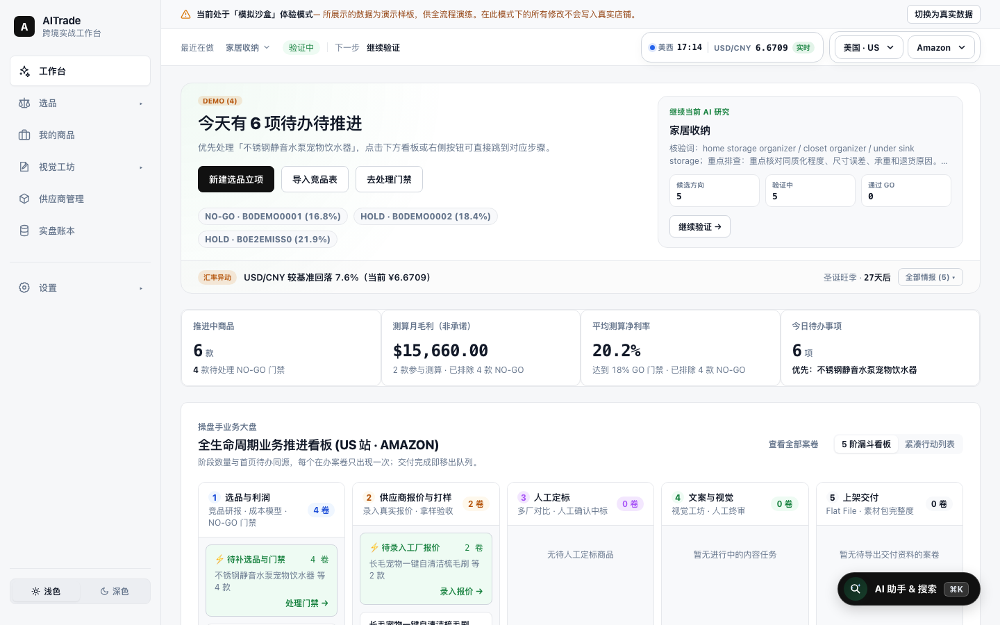
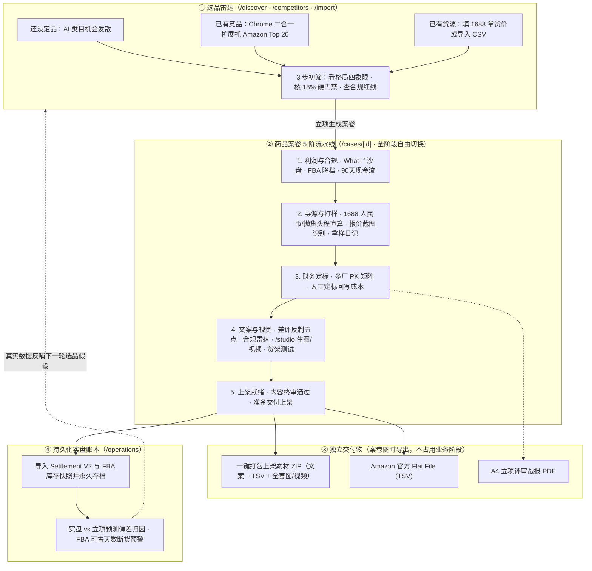

# AITrade

> **跨境电商“反亏钱”立项审计与实战工作台**  
> **AI 只生成待验证假设与素材草稿，结论由真实证据与确定性规则决定。**

无需 Docker、无需付费 API Key，本机 30 秒启动。覆盖 **选品雷达 → 财务/物流/合规门禁 → 1688 寻源与打样日记 → 统一视觉工坊与素材打包 → 持久化实盘账本** 全链路。

| 白天模式（Light） | 黑夜模式（Dark） |
|---|---|
|  |  |

---

## 全链路业务流程



---

## 核心工作流一览

| 入口 | 路由 | 核心能力 |
|---|---|---|
| **1. 工作台** | `/` | 在研案卷全生命周期看板、商业毛利 KPI 概览与待办快捷直达 |
| **2. 选品雷达** | `/discover` `/competitors` `/import` | **3 选 1 选品向导** + **竞品四象限气泡图**（仅用真实采集售价绘制，严禁编造假 P50 与假销量）、按 ASIN 自动去重与重复研报合并、跨站采集自动定位对应站点、按汇率换算人民币采购上限与 CSV 批量导入 |
| **3. 我的商品** | `/cases` `/cases/[id]` | 案卷台账视图与统一 5 阶状态机（`利润与合规 → 寻源与打样 → 财务定标 → 文案与视觉 → 上架就绪`），**全阶段自由切换**：交互式 What-If 财务沙盘、FBA 尺寸降档提醒、90 天现金流回本、前置合规红线清单；独立导出 **上架素材 ZIP**、Flat File (TSV) 与 A4 立项战报 PDF |
| **4. 统一视觉工坊** | `/studio` | 将 **AI 生图**（自定义 Skill + 货架测试）、**AI 视频**（I2V 图生视频 + 异步队列 + `ffmpeg` 多镜头拼接）与 **统一素材库** 合三为一，顶部常驻「当前创作商品」联动归档 |
| **5. 供应商管理与打样** | `/sourcing` `/cases/[id]/sourcing` | 供应商资产库（支持卡片内一键 **`+ 关联商品`** 快速填价入比价表、安全移除未定标工厂）、多厂横向 PK 与定标回写、**微信/1688 报价单截图多模态识别**、**人民币 & 抛货体积重头程直算器**（含 FBA 尺寸降档省钱提示）与 **拿样验货日记** |
| **6. 实盘账本** | `/operations` | 导入 **Amazon Settlement V2 + FBA 库存快照** 并永久落库，沉淀多期实盘经营账本，自动匹配商品案卷输出**实盘 vs 立项毛利偏差**与 **FBA 断货倒计时预警** |
| **7. 实时汇率** | `/fx-rates` | 顶栏常驻当前站点实时汇率胶囊（点击可随时查看、刷新或手动锁定），独立页面管理 8 大跨境币种实时同步、**正向/反向（1 外币 ↔ 1 CNY）双向换算与录入**，全站选品、成本与 1688 报价统一口径 |

### 全局效率、协作与数据安全
- **全局实时汇率引擎**：支持实时外汇拉取（带本地缓存与离线官方基准兜底）、单币种手动锁定与正反向双向换算，修改后实时联动顶栏、选品换算与供应商报价，全部手动调整均写入审计日志。
- **统一数据库持久化**：所有选品案卷、竞品研报、视觉素材清单、打样日记与实盘账本统一存入 PGlite / PostgreSQL，彻底消除分散的本地 JSON 孤岛（自动无损迁移历史本地 JSON）。
- **共享访问口令（可选）**：本机单人使用零门槛免登；如需部署到内网或轻量服务器供多人共享，只需在环境变量配置 `APP_ACCESS_PIN=你的口令`，系统自动通过 Next.js 16 `proxy.ts` 启用口令验证（Cookie 30 天免输）。不做伪前端角色/多租户系统，多人独立使用时直接部署独立实例即可。
- **一键整库备份与恢复**：`/settings` 提供整库业务数据一键脱敏导出（JSON，不含 API Key）与幂等合并恢复，换机或升级零风险。
- **白天 / 黑夜双模主题 & 真实 / 演示双模式**：侧栏一键无缝切换，配套 `npm run theme:check` 主题颜色变量审计门禁。
- **在场式 AI 副驾驶 & 全域检索（`⌘K` / `Ctrl+K`）**：自动感知当前案卷上下文，输出 18% 门禁诊断与 1688 压价底牌话术。

---

## 快速开始

需要 **Node.js 22.6+**，内置嵌入式 PGlite，无需安装数据库或 Docker：

```bash
npm install
npm run dev
```

浏览器打开 <http://localhost:1688> 即可使用（数据默认存储在 `.data/`，首次启动自动生成演示样板）。

- **生产启动**：`npm run build && npm start`
- **共享口令保护（可选）**：`APP_ACCESS_PIN=your-pin npm start`
- **健康检查**：`GET /api/health`（返回 DB 连通性延迟、运行模式与存储配置）

---

## 证据分级与安全边界

系统用确定性代码计算到岸成本、18% 净利率门禁与压力测试，**绝不让 AI 编造销量/售价或替用户凑齐证据**：

| 来源类型（`source_type`） | 说明 | 计入 GO 门禁 / 价格分位 |
|---|---|---|
| `marketplace` / `bulk_text_import` / `manual_verified` | 人工录入或粘贴真实表格 | 是 |
| `captured` | Chrome 扩展采集的前台真实数值 | 是（研报需人工确认） |
| `ai_model_site_import` / `template` / `demo` | AI 或模板推演素材 | **否** |

**明确边界**：
- **不自动外发**：不后台爬取平台、不绕过验证码、不自动联系供应商、不自动下单付款、不自动发布 Listing。
- **API Key 安全**：所有大模型密钥采用本机 AES-256-GCM 加密存储且永不回显；导出模型配置与整库备份均默认脱敏不含 Key。

---

## 扩展与模型配置

### 1. Chrome 二合一跨境实战助手（推荐）
在 Chrome `chrome://extensions` 开启开发者模式并加载已解压扩展 `extensions/aitrade-assistant/`（支持自定义本机 `http://localhost:1688` 或共享服务器地址）：
- **Amazon 搜索页（`/s?k=...`）**：一键采集当前页 Top 20 真实售价、品牌、评分与精确评论数（兼容美/澳/英/德/日等多站点 DOM，采集后自动跳转对应国家站点研报；注意将 Amazon 左上角 Deliver to 邮编设为对应站点本地邮编以显示完整售价）。
- **Amazon 单品详情页 & 评论页（`/dp/...` · `/product-reviews/...`）**：支持 **「竞品对比篮子」**，逛多个单品时逐个点击 `+ 加入对比篮子`（自动提取真实品牌、售价、五点卖点、Amazon Customers say 买家共识与新版 `cardui`/经典 DOM 1–3 星差评），一键打包推送多品深度对比并自动清空篮子。
- **1688 搜索页 & 单品详情页（`detail.1688.com/offer/...`）**：自动拉取 AITrade 在办商品下拉框，支持搜索页批量采集（单次最多 30 家）或单品页单家直采，一键存入 1688 工厂库并自动将人民币报价换算美金写入对应商品比价表。
- 历史独立扩展（`extensions/aitrade-competitor-capture/`、`extensions/aitrade-supplier-capture/`）仍保留兼容。

### 2. 统一大模型配置中心（文本 / 图片 / 视频）
默认免 Key 本地模板即可完整体验。可在 `/settings` 通过「**列表 + 弹窗 + 导出/导入 JSON**」统一管理多套配置并一键切换默认模型：
- **文本大模型**：OpenAI、DeepSeek、Anthropic Claude、火山引擎豆包方舟、阿里云百炼、硅基流动、本地 Ollama 及自定义网关（请求失败自动回退模板）
- **生图模型**：阿里云百炼（Wan / Qwen-Image）、火山引擎即梦 Seedream、Google Gemini（Nano Banana）、硅基流动（FLUX / Kolors）、智谱 CogView-4、fal.ai、Ideogram、OpenAI / Anthropic 兼容网关
- **视频模型（I2V 图生视频）**：快手可灵 Kling（支持 `AK:SK` 自动签发 JWT）、阿里云百炼通义万相（兼容 `wan3.0-video` / `wan2.7-i2v` / `wan2.6-i2v` 及 Token Plan 专属域名）、火山引擎豆包 Seedance、Google Veo、Runway Gen-4、OpenAI Sora / 兼容视频网关
- 环境变量示例见 [.env.example](.env.example)。

---

## 常用命令与目录

```bash
npm run typecheck                  # TypeScript 类型检查
npm run theme:check                # 深浅双模颜色变量审计
npm test                           # 单元测试全量覆盖
npm run build                      # 生产构建
npm run db:reset                   # 清空本地数据库与缓存
npm run report:dry-run -- --help   # 报表 CLI 只读试算
```

```text
src/app/         页面路由、Server Actions 与 API（/discover、/cases、/studio、/sourcing、/operations、/fx-rates、/settings、/unlock）
src/components/  交互组件（选品向导、财务沙盘、四象限图、1688 换算与打样日记、统一视觉工坊、实盘账本、实时汇率管理、整库备份）
src/lib/         确定性经济/物流/合规/结算/实时汇率引擎、ZIP 打包器、AI/生图/视频供应商适配与数据库仓储层
src/proxy.ts     Next.js 16 请求代理（可选 APP_ACCESS_PIN 共享口令保护）
extensions/      Chrome 二合一跨境实战助手（Amazon + 1688）
db/schema.sql    PostgreSQL / PGlite 统一表结构
```
