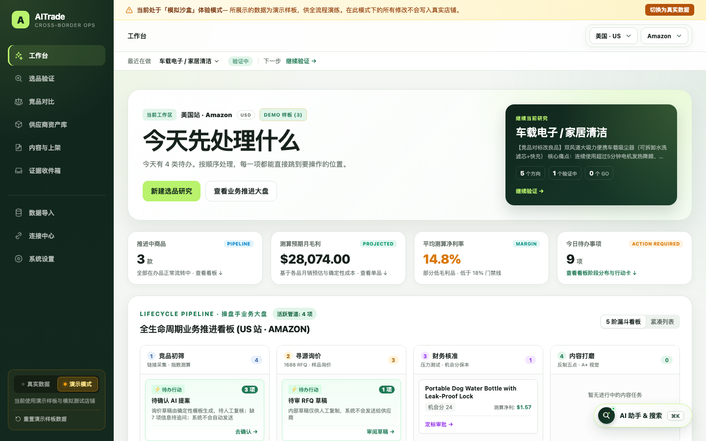
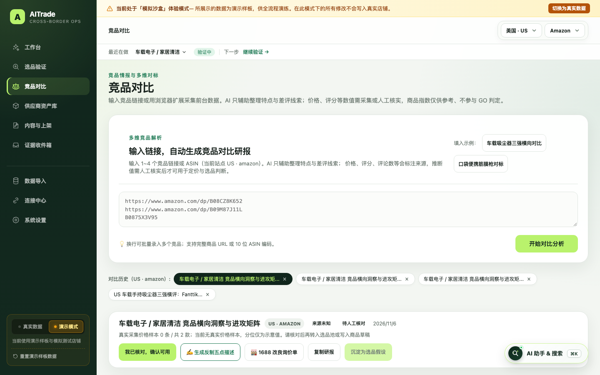
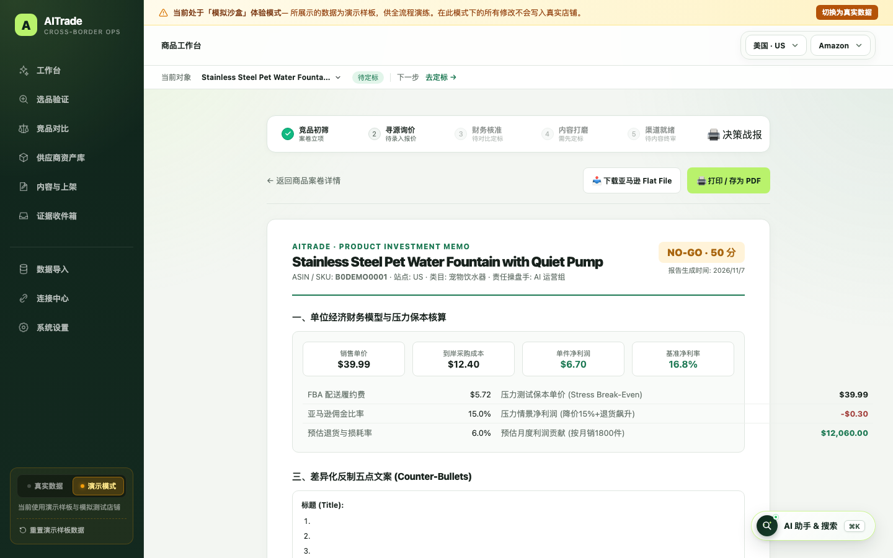
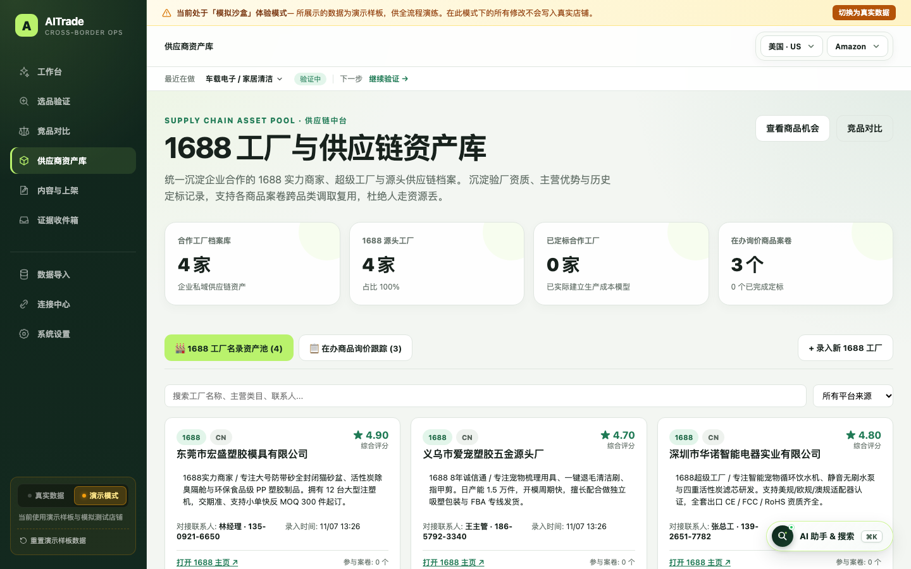
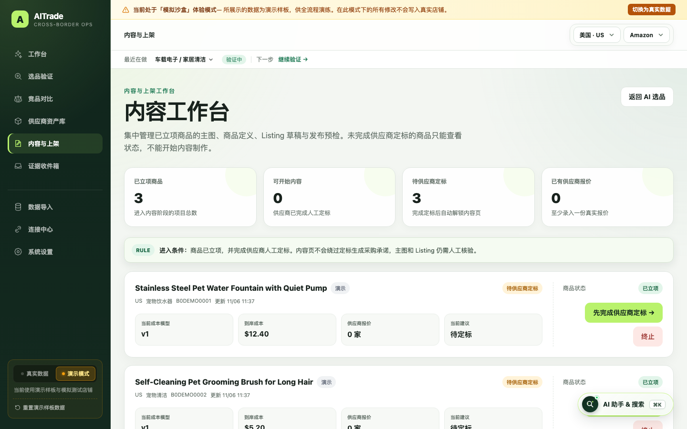

# AITrade

跨境电商运营工作台：选品假设 → 证据核验 → 供应商与成本 → 商品内容 → 发布前检查。AI 只生成待验证假设，结论由证据和确定性规则决定。











## 功能

- 侧边栏「真实数据 / 演示模式」双选切换：全局支持「真实数据 (Live)」与「演示模式 (Sandbox)」环境平滑切换。演示模式下展示预置经典选品样板与模拟测试店铺，顶部呈现沙盒操作警告，支持一键重置回初始样板；切换至「真实数据」后彻底过滤 demo 数据，仅展示真实店铺与核准数据，未录入真实商品时提供清晰的业务启航指引。
- 首页「全生命周期 5 阶流水线看板 (Pipeline Kanban)」与「今日待办」：按「国家 × 平台」隔离数据，将全盘项目规整为 5 阶严密业务漏斗（`1. 竞品初筛` ➔ `2. 寻源询价` ➔ `3. 财务核准` ➔ `4. 内容打磨` ➔ `5. 渠道就绪`）。每列严格保持视觉整齐（单列上限 4 张卡片：有置顶待办时展示 3 个常规项，无待办展示 4 个项），超额项目在列底部提供「查看全部 N 个项目 →」直达对应阶段全量工作台列表；支持看板/紧凑列表双重视图切换，每张卡片附带一键直达的“下一步待办”快捷动作。
- 全局常驻「AI 操盘手助手」与「全域穿梭检索 (Global Spotlight)」：右下角常驻精致悬浮胶囊，支持全局快捷键 `⌘K`（或 `Ctrl+K`）随时呼出。内置双模式：
  - **🔍 全域穿梭检索**：实时模糊匹配候选品案卷、竞品对标研报、1688 询价单、财务测算、Flat File 导出与系统设置，键盘方向键配合回车瞬时直达；
  - **✨ 跨境操盘手 AI 业务助手**：内置 18% 门禁倒推、1688 供应商询价压价话术、美日欧跨站点财税规则差异、外观/专利防侵权排查等实战业务指引；接入大模型或确定性操盘手知识库双轨驱动。
- 竞品对比工作台（`/competitors`）：按「国家 × 平台」隔离研报，支持 1~4 个竞品链接或 ASIN 的横向对标；结合 HHI 垄断指数、评论对数阻力、价格变异系数 CV、贝叶斯评分差评改善胜率构建 5 大科学量化支柱（商品指数 0~100）。研报内集成 **「⚡ 真实工厂报价核算与一键正式立项 (New Case)」**：填入 1688 实报单价（RMB）即时联动汇率、头程运费与 FBA 费率秒测毛利率与财务机会分，一键建立正式商品案卷并关联竞品 ASIN 矩阵、反制五点文案与 1688 RFQ 单。
- 亚马逊竞品采集 Chrome 扩展（`extensions/aitrade-competitor-capture/`）：在商品详情页由用户点击采集前台真实售价、评分、评论数、五点描述与 Top 差评原文，上传后逐字段标为「已采集」，AI 不得覆盖；采集结果进入「待确认」研报而非无标记结论，且端点只接受本机来源，避免复制粘贴与机器人验证码拦截。
- 真实世界交付与决策报表：
  - **亚马逊官方标准 Inventory Flat File (TSV/CSV 批量上传模板)**：一键导出包含 `item_sku`、`brand`、`item_name`、`standard_price`、`bullet_point1~5`、`description` 和 `generic_keywords` 的官方制表符文本，下载后可直接进入卖家后台批量上传。
  - **高审美「立项决策评审战报 (Investment Memo)」与 A4 PDF 打印导出**（`/cases/[id]/report`）：整合商品指数、单位经济压力测试表、1688 材质工艺标准、反制五点文案与选品/采购/运营三方签批栏，专用 `@media print` 样式，一秒保存为专业 PDF 汇报书。
- AI 推荐类目与商品机会，附验证任务和找货线索。
- 选品竞品画像与假设证伪：按 ASIN / 来源 URL 自动去重竞品快照，计算价格分位（`Min / P25 / P50 / P75 / P90 / Max`）、评分/评论数/BSR 中位数、样本覆盖可信度与 3 行假设证伪矩阵（痛点差异化、定价合理性、中位价毛利可行性）；确认售价超 `P90` 时给出高溢价风险提示。
- 选品竞品与差评批量导入：支持基于当前批次的国家站点（US/DE/JP/GB 等）、平台与币种，由 AI 或本地模板生成 10~25 款对标素材，快速铺开价格带与差评主题框架；另提供多行文本 / CSV / JSON 批量粘贴解析（自动提取 ASIN、URL、价格、星级与评论数）。**两者来源不同**：AI / 模板生成物一律标记 `ai_model_site_import` / `ai_site_auto_import`，属待核实素材，**不计入 GO 门禁、差评样本与价格分位，也不能充当定价依据**；人工粘贴的表格（`bulk_text_import`）与人工单条录入（`marketplace`）才作为已核实证据参与门禁。入库自动排重并触发画像重算。
- 商品终止与恢复：首页商品进度可对不再推进的商品执行「终止」（必填原因 + 二次确认 + 审计留痕），终止只改变状态，成本模型、报价、定标、证据与 Listing 草稿全部保留；首页「已终止」区可查看原因并一键恢复。系统不提供逐条硬删除。
- 供应商半自动发现：从选品方向生成中文搜索词，在 1688 当前页由用户触发采集，按确定性规则去重、评分并生成 TOP 10 候选。
- 候选支持 2–4 个横向对比、人工核验、排除和短名单；短名单可生成可复制的内部 RFQ 草稿。
- 证据收件箱（文本 / CSV / JSON / Markdown）与供应商 RFQ 草稿，均需人工审核，不对外发送。
- 确定性门禁给出 GO / HOLD / NO-GO；到岸成本、净利率、压力利润由代码计算，不交给模型。
- 候选品、供应商、报价支持 CSV 或人工录入，保留来源与原始快照。
- 内容工作台竞品对标与差评缺口传承：自动带入关联选品假设的价格带分位、TOP 差评缺口清单与差异化主张，支持一键预填商品定义、生成带原文与证据引用的五点草稿提案，并在本地发布预检中输出非阻断对标提示（差评缺口未覆盖、违规主观对比词、声明红线冲突）。

### 证据分级与边界

AI 只生成待验证假设，系统不替用户「凑够证据」。竞品与差评记录的来源写在 `opportunity_evidence.source_type`：

| 来源 | 含义 | 计入 GO 门禁 / 价格分位 |
|---|---|---|
| `marketplace`、`bulk_text_import`、`manual_verified` | 人工录入、人工粘贴表格 | 是 |
| `captured` | 浏览器扩展采集的前台真实数值 | 是（研报需人工确认） |
| `ai_model_site_import`、`ai_site_auto_import`、`template`、`demo` | AI / 本地模板推演的素材 | **否** |
| 无标记的历史数据 | 按人工证据兼容处理 | 是 |

门禁的竞品数与差评样本、竞品画像的价格分位与覆盖度、内容页的对标提示，都会排除合成来源；详情页对合成记录显示「AI / 模板素材 · 待核实」徽标并给出数量提示。`/competitors` 首次打开不再自动落盘示例研报，研报带 `provenance` 与 `reviewStatus`，本地存于 `.data/competitor-comparisons.json`（`npm run db:reset` 会一并清除）。

不做：自动爬取平台决定竞品是谁、AI 生成或补全 ASIN / 售价 / 评论数并当作事实、未经人审直接入基准、把商品指数当作 GO 阈值、把带占位的草稿直接发布。发布链路仍由数据库 `CHECK (published = FALSE)` 锁死。

AI 与确定性对标模块实现见 `src/lib/competitor-insights.ts`、`src/lib/competitor-auto-import.ts`、`src/lib/competitor-compare/`（含商品指数、反制五点生成与 Chrome 采集端点）、`src/app/competitors/`、`src/lib/ai-proposals/`、`src/lib/ai-inbox/`、`src/lib/ai-supplier-assistant/`。

## 快速开始

Node.js 20.9+，本机直接运行，无需 Docker。

```bash
npm install
npm run dev
```

打开 <http://localhost:3000>。数据默认写入当前目录 `.data/`，首次启动生成演示数据。生产构建：`npm run build && npm start`。

## 半自动供应商发现

完整路径：选品方向 → 打开 1688 → 用户触发采集 → TOP 10 → 候选对比 → 人工核验 / 排除 → 短名单 → RFQ 内部草稿。

1. 在「选品验证 → 找供应商」步骤选择搜索方向，点击“开始找供应商”。
2. 点击“打开 1688”进入对应中文搜索页。1688 链接使用 GBK 编码，避免中文关键词乱码。
3. 使用以下任一方式导入当前页可见商品：
   - Chrome 扩展：在扩展目录 `extensions/aitrade-supplier-capture/` 加载已解压扩展；从页面复制扩展配置并保存，再在 1688 搜索结果页点击“采集当前页并导入 AITrade”。
   - 采集书签：把页面提供的书签拖到浏览器书签栏，在 1688 当前搜索结果页点击运行。
   - 手动导入：把书签复制的 JSON 或包含商品标题和 1688 链接的文本粘贴到采集结果，再点击“导入并生成 TOP 10”。
4. 对比候选后打开来源，核对供应商主体、产品一致性、MOQ、交期和公开信息。只有勾选人工核验的候选才会进入短名单；不匹配的候选可记录原因后排除。
5. 短名单候选可生成 RFQ 内部草稿。草稿只提供复制，系统没有发送入口。

采集只处理用户点击时已经出现在当前 1688 页面上的商品卡，不后台爬取、不自动翻页、不登录、不绕过验证码，也不依赖需要企业主体或企业支付宝的 1688 API。搜索命中不等于供应商已核验，候选信息仍需人工复核。

## 数据接入

在 `/data-sources` 导入 CSV，不需要 API Key：

| 数据 | 模板 |
|---|---|
| 候选品 | `public/candidates-template-v2.csv` |
| 供应商 | `public/suppliers-template.csv` |
| 报价 | `public/quotes-template.csv` |

系统不自动抓取平台数据、不联系供应商、不发布；缺失数据只显示为待补证据。

## AI 模型

默认本地模板，无需 Key。`/settings` 可切换 Ollama 或 OpenAI 兼容接口，请求失败自动回退模板；API Key 不回显到页面。环境变量示例见 [.env.example](.env.example)。

## 边界

- 平台连接只读，不支持真实写入或发布。
- 1688 供应商采集是浏览器侧、用户触发的半自动流程；不自动联系供应商、不发送 RFQ、不下单、不付款。
- 本地原型，无登录、角色权限与多租户；演示商品不代表真实市场结论。
- P3.0 经营报表计算层是纯函数试算，尚未接入真实结算单与库存快照。

## 常用命令

```bash
npm run typecheck   # 类型检查
npm test            # 单元测试
npm run build       # 生产构建
npm run db:reset    # 清空本地数据库
npm run report:dry-run -- --help   # 报表试算（只读、不写库）
npm run screenshots # 改 UI 后重拍截图，图片随提交一起更新
```

报表试算的口径参数由 `--config` 显式给出，不内置阈值；列名依据平台公开规范，仍需用真实导出核对。代码图谱重建用 `graphify extract . --code-only` 与 `graphify cluster-only . --no-label`，不要用 `graphify update .`。

## 项目结构

```text
src/app/        页面、Server Actions 与 API
src/lib/        确定性计算、导入、AI 提取与报表管线
scripts/        报表试算 CLI 与截图脚本
db/schema.sql   表结构
```
